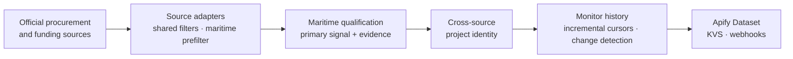

# EU Maritime & Port Opportunity Monitor

### Monitor Europeo de Oportunidades Marítimas y Portuarias

> Procurement intelligence for companies working in ports, maritime construction and coastal infrastructure.

**Private source · Public showcase · Version 0.2**

The EU Maritime & Port Opportunity Monitor is an Apify Actor for companies that need to find and follow
public procurement opportunities before they disappear into an unfiltered notice feed. It focuses on
ports, dredging, coastal works, terminals, shore power and related maritime engineering services.

The source project remains private. This repository is the public window into the product: it explains
the problem, the signal model and the intended workflow without publishing implementation code, private
test data or deployment configuration.

## What it monitors

- port, harbour, quay, berth, jetty, breakwater and terminal works;
- dredging, reclamation and coastal-protection projects;
- mooring, fendering, navigation, VTS and port-safety systems;
- shore-side electricity, alternative fuels and port decarbonisation;
- maritime engineering, geotechnical, environmental and blue-economy services.

## Who it is for

The Actor is designed for marine contractors, engineering consultancies, dredging and coastal-works
specialists, port-equipment suppliers, shore-power providers, terminal operators and business-development
teams preparing bids in Spain and the European Union.

It is procurement intelligence for companies. It is not a jobs, vacancies, candidates or employment
scraper.

## How a monitor works

1. **Official sources.** Spanish and European procurement and funding interfaces are queried with one
   shared filter model: countries, NUTS regions, CPV branches, keywords, budget and publication date
   mean the same thing in every source.
2. **Maritime prefilter.** Only notices with a maritime CPV branch or maritime terminology are kept for
   qualification, so the scan budget is spent on relevant records.
3. **Deterministic qualification.** A notice qualifies only with a primary maritime signal (a maritime
   CPV code or a strong maritime term in its title). Supporting terms and buyer signals add evidence,
   and known false positives, such as network-switch "ports" or loading docks, are excluded.
4. **Cross-source identity.** The same project published in several sources becomes one event that
   keeps every official source as evidence.
5. **History and change detection.** A stable monitor profile remembers what it has already reported
   and emits only meaningful lifecycle events: `NEW`, `UPDATED`, `DEADLINE_CHANGED`, `AWARDED` or
   `CANCELLED`. A missing notice is never treated as a cancellation.

Every qualified result carries the rules that matched and the links to the official notice. The product
does not use an LLM or an opaque probability-of-winning score.

## Built for recurring monitors

- **Incremental scanning.** Each scheduled run continues from where the previous run stopped in each
  source, instead of downloading the same weeks of notices again.
- **Nothing is silently dropped.** When a run reaches its result limit or its spending limit, the
  remaining events are deferred to the next run, ordered by relevance.
- **Honest coverage.** Each run reports, per source, whether coverage was full, partial or failed, and
  why. Partial or failed scans never produce negative lifecycle conclusions.
- **Bounded and billing-safe.** Inputs, scans and stored history have explicit limits, and an event is
  never billed twice, even after a restart.

## Official signal families

- **PLACSP** — Spanish preliminary consultations, tenders, awards and cancellations.
- **TED** — European procurement notices and awards.
- **EU Funding & Tenders** — calls and funded-project signals that may precede procurement.

The public documentation points to the official interfaces; it does not copy notices, tender documents
or private customer data.

## Architecture at a glance

The [architecture note](docs/ARCHITECTURE.md) describes the public product boundary. The [roadmap](docs/ROADMAP.md)
describes the current direction without exposing private implementation details.

## Current boundary

This showcase does not contain:

- the private Actor source code, Docker files or deployment configuration;
- credentials, deploy keys or private Apify settings;
- copied tender documents, client data or proprietary datasets;
- PDF interpretation, bid recommendations or probability estimates.

Examples and future screenshots will use synthetic or deliberately anonymised data. Official values
remain attributable to their source and should be verified before bidding.

## About this repository

This is a documentation-first showcase. The private source repository is the system of record; this
repository is synchronised from a reviewed public subset by GitHub Actions. See [NOTICE.md](NOTICE.md)
for the publication boundary.

## En español

EU Maritime & Port Opportunity Monitor es un Actor de Apify para empresas que buscan licitaciones y
señales tempranas de contratación pública en puertos, dragados, obras marítimas, protección costera,
terminales y descarbonización portuaria.

Consulta fuentes oficiales españolas y europeas (PLACSP, TED y Funding & Tenders), aplica un mismo
modelo de filtros en todas ellas y califica cada anuncio con reglas marítimas deterministas: hace
falta una señal principal, como un código CPV marítimo o un término marítimo claro en el título. Cada
resultado incluye las reglas que lo calificaron y los enlaces al anuncio oficial.

Pensado para monitores programados: cada ejecución continúa donde se quedó la anterior, los eventos que
superan el límite de resultados o de gasto se aplazan a la siguiente ejecución en vez de perderse, y un
mismo evento nunca se cobra dos veces.

No es un extractor de empleo. El código fuente permanece privado; este repositorio solo documenta el
producto, su alcance y su evolución pública.
