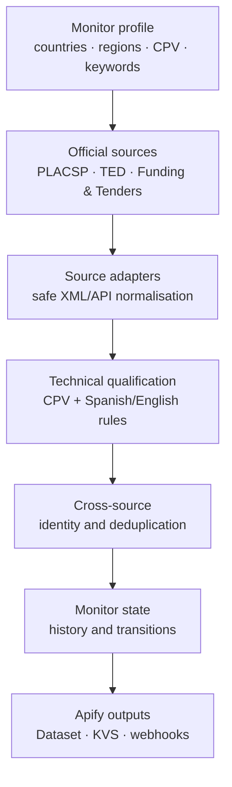

# Public architecture view

This page describes the product boundary without publishing implementation details.

## Design goals

### Official, traceable signals

Each opportunity remains linked to the official notice, award or funding record that produced it.
The monitor is intended to shorten discovery time, not to replace verification of the source notice.

### Deterministic qualification

Qualification combines maritime CPV families, Spanish and English technical terms and authority
signals. A notice needs a primary maritime signal, either a maritime CPV code or a strong maritime term
in its title; supporting terms only add evidence, and known false positives are excluded. Matched rules
are returned with each result so that the qualification can be inspected and adjusted by the user.

### Shared filter semantics

Countries, NUTS regions, CPV branches, keywords, budget and publication date mean the same thing in
every official source. A filter only excludes a notice that publishes the filtered field with a
different value, so incomplete upstream records are left to the qualification step instead of being
dropped.

### Stable history

A `monitorId` identifies a commercial monitoring profile. Reusing it lets the Actor compare a new scan
with the last successful observation and emit meaningful lifecycle changes without billing the same
event twice. A run without a `monitorId` is a one-off snapshot: it reports every qualified opportunity
in the lookback window and keeps no history.

Scheduled runs are incremental: each source continues from where the previous run stopped, and a change
of filters restarts the lookback window. Events beyond the run's result or spending limit are deferred
to the next run, most relevant first, instead of being dropped. Each run reports per-source coverage so
that a partial scan is visible and never produces negative lifecycle conclusions.

### Private implementation, public communication

The public repository documents the product shape and operating boundary. The implementation, fixtures,
private tests and deployment details remain in the private repository.

## Technology direction

- Runtime: Python Actor on Apify.
- Integrations: official public interfaces for Spanish and European procurement and funding.
- Output model: traceable opportunity events with source evidence and change metadata.
- Current release (0.2): API-first, deterministic and without LLM enrichment or PDF interpretation.
